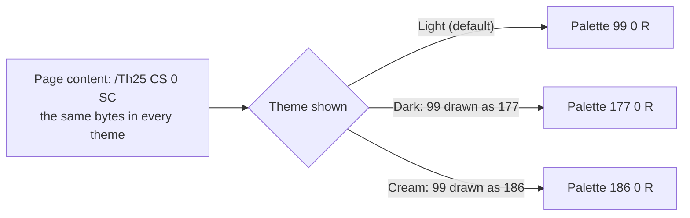

# Colour themes in PDF

| | |
| --- | --- |
| **Version** | Draft 0.3, October 2026 |
| **Editor** | Mathew Newman |
| **Status** | Working draft for discussion with the PDF Association's PDF Technical Working Group |
| **Discussion** | [pdf-association/pdf-issues#369](https://github.com/pdf-association/pdf-issues/issues/369) |
| **Implementation** | `pdfthemes` in this repository, and the [live demo](https://thenewmanator15.github.io/pdf-themes/) |
| **See also** | [Limits](https://thenewmanator15.github.io/pdf-themes/limits/) and [ROADMAP.md](ROADMAP.md) |

This is a working draft for discussion with the PDF Association's PDF Technical
Working Group. It describes what `pdfthemes` in this repository writes and
reads.

> [!NOTE]
> Key names are provisional: the proof of concept stores the theme
> dictionary under the private key `XXThemes` (a third-class name, ISO 32000-2
> Annex E). A standard would use a first-class key, written here as `Themes`.

> [!TIP]
> **Shall** marks a requirement, **should** a recommendation and **may** a
> permission, as in ISO 32000-2.

## Contents

1. [What it does](#1-what-it-does)
2. [Terms](#2-terms)
3. [The themes dictionary](#3-the-themes-dictionary)
4. [Theme dictionaries](#4-theme-dictionaries)
5. [Replacements](#5-replacements)
6. [Writers](#6-writers)
7. [Standard themes](#7-standard-themes)
8. [Checking](#8-checking)
9. [Readers](#9-readers)
10. [Security](#10-security)
11. [Where colour lives in a PDF, and how a theme reaches it](#11-where-colour-lives-in-a-pdf-and-how-a-theme-reaches-it)
12. [Open questions](#12-open-questions)
13. [Example](#13-example)

## 1. What it does

A PDF can carry more than one set of colours for the same content. The
content streams, text, fonts and structure tree are stored once. Each
alternate theme lists objects to draw in place of others: mostly palettes,
sometimes a gradient, an opacity setting, an image's palette or a colour value
outside the page content.

Choosing a theme is a view setting, like draft mode or overprint preview. A
reader that supports themes picks one from the person's settings, paints the
theme's paper colour and draws the pages with the swapped objects. A reader
that doesn't support themes ignores them and shows the default colours.



## 2. Terms

| Term | Meaning |
| --- | --- |
| **Default theme** | The colours as written in the file. |
| **Alternate theme** | A theme that replaces some objects with others. |
| **Palette** | An Indexed colour space (ISO 32000-2, 8.6.6.3) that content streams use for solid colours, for example `/Th25 CS 0 SC`. |
| **Replacement** | A pair of indirect objects. While the theme is shown, the first object is drawn as the second. |
| **Authored theme** | A theme the author built, with its own colours for text, charts and pictures. |
| **Derived theme** | An alternate theme the writer worked out from the default theme rather than one the author built. A fallback for a file with no source to build from. |
| **Contrast ratio** | As WCAG 2.2 defines it, from the relative luminance of two colours. Success criteria are cited by number and name, for example 1.4.3 Contrast (Minimum). |
| **Enhanced contrast** | WCAG's term for the 7:1 level of success criterion 1.4.6. A theme with `Contrast` `More` is an enhanced contrast theme. |
| **Forced colours** | A mode in which the person's own colours replace the document's, such as a Windows contrast theme (CSS `forced-colors`). |

## 3. The themes dictionary

The document catalog's `Themes` entry is a dictionary:

| Key | Type | Required | Value |
| --- | --- | --- | --- |
| `Default` | dictionary | Required | A theme dictionary describing the default theme. It shall not contain `Replace`. |
| `Alternates` | array | Required | One or more theme dictionaries for alternate themes. |

## 4. Theme dictionaries

| Key | Type | Required | Value |
| --- | --- | --- | --- |
| `Type` | name | Optional | `Theme`. |
| `Name` | text string | Required | The name a reader shows, for example `(Dark)`. Unique within the file. |
| `ColorScheme` | name | Required | `Light` or `Dark`: the setting this theme suits, as in CSS `prefers-color-scheme`. |
| `Contrast` | name | Optional | `More` for an enhanced contrast theme (WCAG 1.4.6), made for people who ask for more contrast, as in CSS `prefers-contrast: more`. Absent means standard contrast. |
| `Tint` | name | Optional | The tint of a tinted theme, from section 7, for example `Cream`. Absent means no tint. |
| `Paper` | array | Optional | Three numbers from 0 to 1: the sRGB colour a reader paints before drawing each page. Default: `[1 1 1]`. |
| `Checked` | dictionary | Optional | What the writer checked this theme against (section 8). |
| `Replace` | array | Required in alternate themes | An even number of indirect references, read in pairs `base replacement`. |

`ColorScheme`, `Contrast` and `Tint` are labels a reader can match from one
document to the next. `Name` is for people and may be translated.

## 5. Replacements

1. Each element of `Replace` shall be an indirect reference.
2. A base object shall be one of these, and its replacement the same kind:

   | Base | The replacement shall keep |
   | --- | --- |
   | An Indexed colour space (a palette) | the same `hival`. Its base colour space may differ. |
   | Another colour space | the same family and number of components. |
   | A function | the same number of inputs and outputs. |
   | A shading or a shading pattern | the same shading type, geometry (`Coords`, `Domain`, `Extend`, `BBox`, `Matrix`) and, for meshes, the same vertices. |
   | A graphics state parameter dictionary | everything except `CA`, `ca` and `BM`. |
   | An image XObject, or a page thumbnail | the same `Width`, `Height`, `SMask` and `Mask`. |
   | A colour value: an array of 0, 1, 3 or 4 numbers, or an array of such arrays | the same structure. Used for annotation `C` and `IC`, `MK` `BG` and `BC`, bookmark `C`, `BoxColorInfo` `C`, soft mask `BC`, structure attributes such as `Color` and `BorderColor`, and portfolio colours. |
   | A text string that carries colour: `DA`, `DS` or `RC` | everything except its colour operators or CSS colour values. |
   | An annotation dictionary | everything except `C`, `IC`, `CA`, `ca`, `BM`, `DA`, `DS` and `RC`. |

   > [!IMPORTANT]
   > A base object shall not be a page, a content stream, a form XObject, a
   > font, an optional content group, an action or anything in the structure
   > tree other than an attribute's colour value. A theme can therefore repaint
   > a document but cannot change its content streams, its text, its structure
   > or what it does. It can still change what is seen, for example with a
   > replacement image or a text colour that matches the paper (section 10).
3. A base object shall appear at most once in a theme's `Replace` array.
4. While a theme is shown, every reference to a base object in the document
   shall be resolved to its replacement, wherever it is referenced from.

## 6. Writers

- A writer should paint every solid colour through a palette, so that one
  replacement recolours the document. An Indexed space holds at most 256
  colours; a document that needs more uses several palettes.
- A writer should give text, fills and strokes their own palette entries, even
  where the colours are the same, so a theme can change one without the
  others.
- A palette's base colour space should be the space the colour was written in.
  Colours a writer works out itself should be in an ICC-based sRGB space; a
  file that already has an sRGB profile should use it, which keeps PDF/A
  files within their rules.
- The default theme shall be a complete document on its own: a reader that
  ignores `Themes` shows it correctly.
- Images that differ between themes but share their shapes should be written
  once, as indices into a palette, with a palette per theme. A full replacement
  image is allowed, but costs its full size.
- A grey image of a page, such as a scan, may be given an Indexed colour space
  over its own grey space in which each entry is the grey of its own index.
  It draws exactly as before, its data isn't changed, and a theme replaces the
  palette. Scans that share a colour space and bit depth can share a palette.
- The themes in a file should be ones its author built: the document made
  once per theme, from one source, with every build drawing the same text and
  shapes. A writer should make this easy, and should let the author look at
  each theme before the file goes out.
- A writer may derive a theme only where the author asks for it or there is
  no source to build from, and should leave out a derived theme that fails
  its check or that draws every page exactly as the default theme does.
- A writer shall not change a colour in an authored theme.

## 7. Standard themes

| Name | `ColorScheme` | `Contrast` | `Tint` | For |
| --- | --- | --- | --- | --- |
| Light | Light | | | The author's design. |
| Dark | Dark | | | Light sensitivity, glare, reading in the dark, some low vision. |
| Light, more contrast | Light | More | | Low vision. Enhanced contrast. |
| Dark, more contrast | Dark | More | | Low vision with light sensitivity. Enhanced contrast. |
| Cream, Peach, Yellow, Turquoise | Light | | the same as the name | Readers who find a tinted background easier, including many with dyslexia or visual stress. It does the job of a coloured overlay. Which tint helps differs from person to person, hence a range. |

WCAG 2.2 success criterion 1.4.8 Visual Presentation asks that the person can
select foreground and background colours. A reader that recolours the page
meets that today, at the cost of the design. The standard themes give the
person a set to select from, each with its text contrast checked by the
writer.

> [!IMPORTANT]
> This is the set an author is asked to build. A themed file should carry a
> theme with `ColorScheme` `Dark` and one with `ColorScheme` `Dark` and
> `Contrast` `More`, because a reader who needs light text on dark otherwise has
> to invert the page. It need not carry the rest, and may carry others.

This draft doesn't specify how a writer works out a derived theme, only its
labels and the check it shall pass. The proof of concept's method is in
`pdfthemes/derive.py`.

## 8. Checking

A writer should check each theme before writing it, at least the contrast of
all text against what is drawn behind it, using the WCAG 2.2 contrast ratio.
For an authored theme the writer reports what fails, with the page and the
text, and leaves the fixing to the author. It writes the theme either way,
without `Checked` if it failed.
The check should be made on the drawn page, so it sees gradients, images and
transparency as a reader shows them. Themes should be held to these levels:

| Themes | Success criterion | Text | Large text | Level |
| --- | --- | --- | --- | --- |
| With `Contrast` `More` | 1.4.6 Contrast (Enhanced) | 7:1 | 4.5:1 | AAA |
| All others | 1.4.3 Contrast (Minimum) | 4.5:1 | 3:1 | AA |

Screens, brightness and room light all change how contrast looks, so a writer
fixing a colour should aim a little above the minimum.

This draft asks for a check of text only. Graphics that carry meaning, such
as chart lines, icons and the borders of form fields, come under 1.4.11
Non-text Contrast (3:1), and a chart that tells its series apart by colour
alone comes under 1.4.1 Use of Color. A writer may check those as well (open
question 13).

> [!NOTE]
> `Checked` records the success criterion the writer's check was made against,
> and that the check passed. It is not a claim that the theme conforms to that
> criterion: an automated check can't judge everything WCAG asks, and a writer
> may not be able to measure some text, such as text filled with a gradient.

| Key | Type | Value |
| --- | --- | --- |
| `Standard` | text string | For example `(WCAG 2.2)`. |
| `Criterion` | text string | For example `(1.4.3 Contrast (Minimum))`. |
| `Level` | name | For example `AA`. |
| `Date` | date | When the check was made. |

A writer shall not write `Checked` for a theme that failed the check, or for
one in which there was no text to check. A writer should report any text it
could not measure, with the page and the text (open question 14).

PDF/UA covers structure and tagging. Its tests for PDF/UA-1, the Matterhorn
Protocol 1.1, have one check on colour (04-001: meaning shown by colour or
contrast must also be in the tags) and set no contrast ratio, so a writer
checks against WCAG's. The rules public bodies work to, such as EN 301 549 in
Europe and Section 508 in the United States, apply WCAG's level AA criteria to
documents, and 1.4.3 is one of them. `Checked` is where a themed file says
which criterion each theme was checked against.

## 9. Readers

- A reader should choose the theme whose `ColorScheme` and `Contrast` match
  the app or system setting, and, once a person picks a tint, the theme with
  that `Tint` in later documents too. With no match, it shows the default
  theme.
- A reader should offer a way to choose any theme in the file.
- A reader shall paint the theme's `Paper` colour before drawing each page.
- A reader shall apply a theme's replacements as described in 5.4, and nothing
  else changes: text extraction, search, the structure tree, links and form
  fields behave the same in every theme.
- Theme colours are colour managed like any other colours in the file.
- A reader should print the default theme unless the person chooses another.
- When the person has turned on forced colours (for example a Windows
  contrast theme, CSS `forced-colors: active`), the reader's forced colours
  take precedence over any theme.
- A reader shall ignore a theme it cannot apply, for example one whose
  replacements break the rules in section 5, and show the default theme.

## 10. Security

Choosing a theme changes no bytes in the file, so a signature covers every
theme.

> [!WARNING]
> A theme could still be used to hide content from one reader of a signed
> document, for example by painting text in the paper colour.

Because a theme cannot change content streams, the check is narrow:

- a reader validating a signature should say which theme is shown;
- a validator should draw every theme and check text contrast in each, and
  list every replacement image, since a contrast check can't see what an
  image shows;
- a signing profile may restrict alternate themes to palettes, gradients,
  colour values and opacity, with no replacement images.

## 11. Where colour lives in a PDF, and how a theme reaches it

| Where | How a theme changes it |
| --- | --- |
| Solid colours in content streams, in any colour space | Palette entries |
| Colours inside form XObjects, tiling patterns, Type 3 glyphs, annotation appearances and soft mask groups | Palette entries, the same way |
| Gradients (shading patterns and `sh`) | A replacement shading or pattern |
| Opacity and blend modes | A replacement graphics state |
| Images | A replacement palette (Indexed images, and images stored as indices), or a replacement image |
| Stencil masks and image masks | The fill colour, a palette entry |
| Inline images | Written as image XObjects, then as images |
| Annotation, form field, bookmark, structure and portfolio colours | Replacement colour values, strings or annotation dictionaries |
| Page thumbnails | A replacement image |
| The page background | `Paper` |

## 12. Open questions

| # | About |
| --- | --- |
| 1 | Where the themes live: a catalog key or optional content |
| 2 | Thicker lines in a higher contrast theme |
| 3 | Paper as sRGB or a palette entry |
| 4 | Printing when the default theme is dark |
| 5 | What `Checked` holds |
| 6 | Appearances a reader makes itself |
| 7 | HTML derived from tagged PDF |
| 8 | Which tints |
| 9 | Wide-gamut colours in derived themes |
| 10 | Dark paper on OLED screens |
| 11 | Editing while a theme is shown |
| 12 | Stale themes |
| 13 | Non-text contrast and colour vision deficiency |
| 14 | Text a writer can't measure |
| 15 | Colour fonts |
| 16 | Colours set by scripts |
| 17 | 3D models and media |
| 18 | Attached files |
| 19 | Signed files |

1. A catalog key, or an extension of optional content configurations?
2. Should a theme be allowed to change line width, so a higher contrast theme
   can thicken thin lines? `LW` in a replacement graphics state would do it,
   and Poppler, MuPDF and PDFium already draw it. Readers with low vision
   find grid lines and tick marks in charts too thin and too pale
   ([Wang, Zhao and Kim 2024](https://doi.org/10.1145/3613904.3642188)), but
   nobody has measured how much bolder lines help, and it would need a limit
   so a line can't cover what is beside it.
3. Paper as sRGB, or as a palette entry? Should it also colour the space
   around pages?
4. Which theme prints when the default theme is dark?
5. Free text in `Checked`, or a minimum contrast ratio a validator can test?
6. Should readers theme the appearances they make themselves (highlights,
   form fields without appearance streams)? A reader draws these anyway, as
   it draws a comment's pop-up window and its list of comments in its own
   interface, so it can draw them in the theme shown.
7. Should HTML derived from tagged PDF carry the themes as CSS?
8. A fixed list of tints, or any named tint?
9. Derived themes for wide-gamut colours such as Display P3: worked out in the
   file's own colour space rather than sRGB?
10. Dark paper on OLED screens: pure black can smear when scrolling, which is
    why many dark designs use a dark grey. Should `Paper` have a preferred
    range?
11. Editing: when a person adds a highlight while a theme is shown, which
    theme's colours does it take?
12. Stale themes: a tool that doesn't know about themes can add content, say
    black text, that no theme recolours, so it disappears on dark paper.
    Should `Checked` record what was checked (a digest of the page content,
    for example), so a reader can tell when the themes no longer match the
    pages and fall back to the default?
13. Should the check cover 1.4.11 Non-text Contrast, so chart lines and other
    graphics are held to 3:1 in every theme? Should a theme be able to say it
    was made for colour vision deficiency?
14. Text a writer can't measure, such as text filled with a gradient: should
    it stop `Checked` from being written, or be recorded in it, for example
    as a count?
15. Colour fonts: a font can carry its own colours, as colour emoji do, and a
    font can't be a base object (section 5), so those colours are the same in
    every theme. Should a theme be able to replace a font's colour palette, or
    should a writer draw such glyphs another way, for example as Type 3
    glyphs that paint through palettes?
16. Colours set by scripts: a form's JavaScript can colour a field when its
    value changes, for example red for a negative number. That colour is in
    the script, out of a theme's reach. Should a script be able to ask for a
    colour of the theme shown?
17. 3D models and media: a theme reaches the PDF's own colours round a 3D
    model (background, render mode, cross-sections) but not the model's
    materials and lighting, nor video. Should a theme be able to name a 3D
    view of its own, or do these stay the same in every theme, as photos do?
18. Attached files: a PDF attached to a themed PDF, or held in a portfolio,
    has its own themes or none. Should a reader open an attached file in the
    theme matching the one shown?
19. Signed files: showing a theme changes no bytes, but adding or changing
    themes does, so a signature made before no longer covers the file. Should
    adding themes be a change that a certification signature's permissions
    (DocMDP) can allow in an incremental update, as filling in a form is?

## 13. Example

```text
1 0 obj
<< /Type /Catalog /Pages 2 0 R
   /Themes <<
     /Default << /Type /Theme /Name (Light) /ColorScheme /Light /Paper [1 1 1] >>
     /Alternates [ << /Type /Theme /Name (Dark) /ColorScheme /Dark /Paper [0.0941 0.098 0.1098]
                      /Replace [ 99 0 R 177 0 R ] >>
                   << /Type /Theme /Name (Cream) /ColorScheme /Light /Tint /Cream
                      /Paper [0.9922 0.9647 0.8902] /Replace [ 99 0 R 186 0 R ] >> ]
   >>
>>
endobj

99 0 obj  [/Indexed [/ICCBased 987 0 R] 5 <C0832A 879594 C0832A 879594 9F9464 6C9C9F>] endobj
177 0 obj [/Indexed [/ICCBased 987 0 R] 5 <FFA90E 94A4A2 FFA90E 94A4A2 B9AC70 92DADD>] endobj
186 0 obj [/Indexed [/ICCBased 987 0 R] 5 <B47C2C 808E8D B47C2C 808E8D 968D60 669295>] endobj

% in a content stream, the same bytes in every theme:
/Th25 CS 0 SC
```

The numbers are from one palette of the theme lab's file in `demo/`: six plot
colours, as fitted to white paper, to dark paper and to cream. The file's
other palettes and its other six themes are left out.
