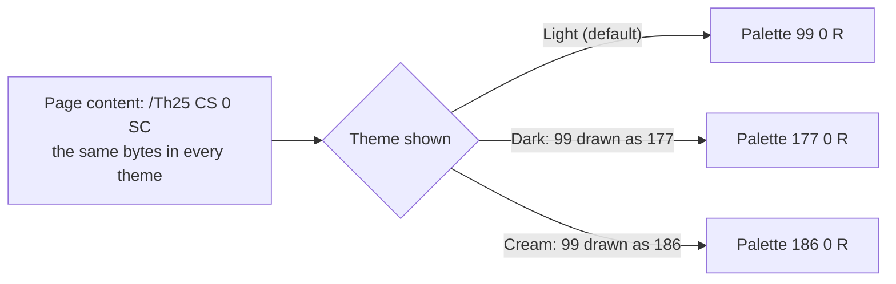
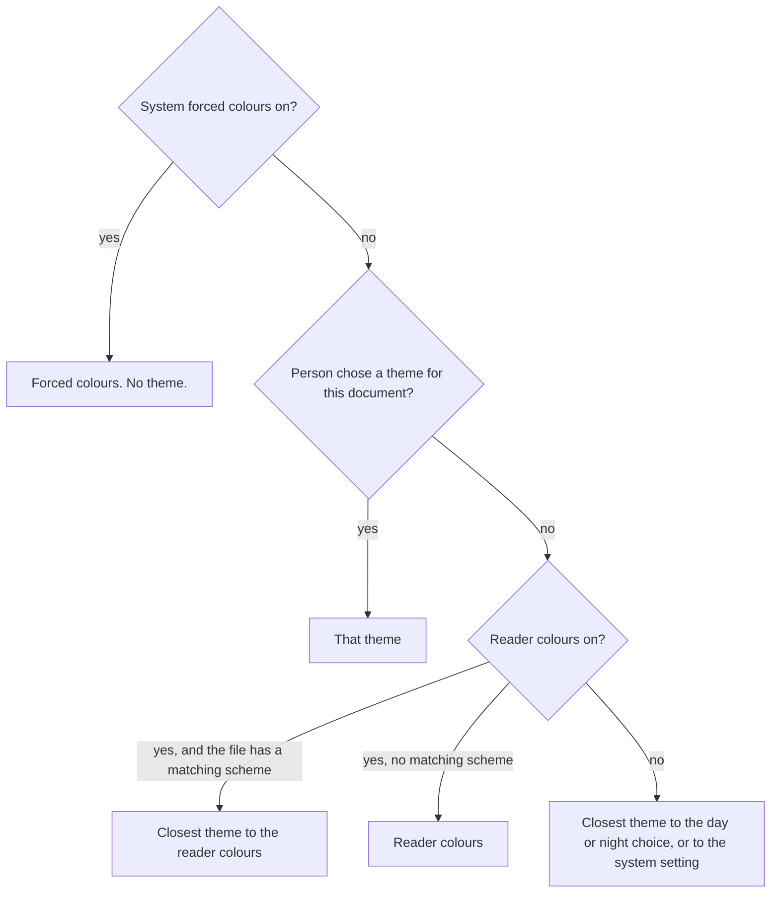

# Colour themes in PDF

| | |
| --- | --- |
| **Version** | Draft 0.5, November 2026 |
| **Editor** | Mathew Newman |
| **Status** | Working draft for discussion with the PDF Association's PDF Technical Working Group |
| **Discussion** | [pdf-association/pdf-issues#369](https://github.com/pdf-association/pdf-issues/issues/369) |
| **Implementation** | `pdfthemes` in this repository, and the [live demo](https://thenewmanator15.github.io/pdf-themes/) |
| **See also** | [Limits](https://thenewmanator15.github.io/pdf-themes/limits/) and [ROADMAP.md](ROADMAP.md) |
| **Changes** | [Annex E](#annex-e-informative-changes-since-draft-03) |

> [!NOTE]
> Draft 0.4 is laid out the way an ISO document is: scope, references, terms
> and conformance first, then the file format, then what each kind of software
> shall do. Every rule has an identifier such as **R7.2-1**, and
> [Annex A](#annex-a-normative-test-suite) names the test file that shows a
> product follows it.

## Contents

- [Introduction](#introduction)
1. [Scope](#1-scope)
2. [Normative references](#2-normative-references)
3. [Terms and definitions](#3-terms-and-definitions)
4. [Conformance](#4-conformance)
5. [The themed file](#5-the-themed-file)
6. [Writers](#6-writers)
7. [Readers](#7-readers)
8. [Editors](#8-editors)
9. [Checkers](#9-checkers)
10. [Security and privacy](#10-security-and-privacy)
- [Annex A (normative): Test suite](#annex-a-normative-test-suite)
- [Annex B (informative): Where colour lives in a PDF](#annex-b-informative-where-colour-lives-in-a-pdf)
- [Annex C (informative): Example](#annex-c-informative-example)
- [Annex D (informative): Open questions](#annex-d-informative-open-questions)
- [Annex E (informative): Changes since draft 0.3](#annex-e-informative-changes-since-draft-03)
- [Annex F (informative): Figures with a value per theme](#annex-f-informative-figures-with-a-value-per-theme)

## Introduction

A PDF can carry more than one set of colours for the same content. The
content streams, text, fonts and structure tree are stored once. Each
alternate theme lists objects to draw in place of others: mostly palettes,
sometimes a gradient, an opacity setting, an image's palette or a colour value
outside the page content.

Choosing a theme is a view setting, like draft mode or overprint preview. A
reader that supports themes picks one from the person's settings, paints the
theme's paper colour and draws the pages with the swapped objects. A reader
that doesn't support themes ignores them and shows the default colours.



Readers today offer dark modes and reading colours by working out new colours
from the page as it is drawn. That can't tell a chart's series apart from its
text, and images, gradients and patterns are left as they were. A themed file
carries colours the author chose and checked for each theme, so every table,
chart and figure looks as intended, and a theme for low vision can draw thin
lines bolder (6.4).

## 1. Scope

This document specifies:

- how a PDF file carries alternate colour themes (section 5);
- what software that writes, reads, edits or checks such a file shall do
  (sections 6 to 9);
- a test suite that shows whether a product does it (Annex A).

It does not specify:

- how a writer works out a theme the author didn't build (a derived theme);
  only the labels such a theme carries and the check it shall pass;
- the colours of a reader's own interface, such as its toolbars, comment
  pop-ups and comments panel;
- changes to content streams, fonts, text or structure. A theme can't make
  them (5.3);
- the final name of the catalog key (4.4).

It applies to PDF 2.0 files (ISO 32000-2). Nothing in it stops a PDF 1.x file
from carrying themes, and the test suite includes PDF 1.7 files.

## 2. Normative references

- ISO 32000-2:2020, *Document management — Portable document format — Part 2:
  PDF 2.0*, with the PDF Association's published errata
- ISO 14289-1 and ISO 14289-2, *PDF/UA*
- W3C, *Web Content Accessibility Guidelines (WCAG) 2.2*: the contrast ratio
  and success criteria 1.4.3, 1.4.6, 1.4.8 and 1.4.11
- W3C, *Media Queries Level 5*: `prefers-color-scheme`, `prefers-contrast`
  and `forced-colors`
- IEC 61966-2-1, *sRGB*

## 3. Terms and definitions

| Term | Meaning |
| --- | --- |
| **Themed file** | A PDF file whose catalog carries a themes dictionary (5.1). |
| **Theme** | A set of colours in which the whole document can be shown. |
| **Default theme** | The colours as written in the file. |
| **Alternate theme** | A theme that replaces some objects with others. |
| **Theme shown** | The theme a reader is drawing the document in. |
| **Palette** | An Indexed colour space (ISO 32000-2, 8.6.6.3) that content streams use for solid colours, for example `/Th25 CS 0 SC`. |
| **Replacement** | A pair of indirect objects, the **base** and its **replacement**. While the theme is shown, the base is drawn as the replacement. |
| **Labels** | A theme's `ColorScheme`, `Contrast` and `Tint`: what a reader matches from one document to the next. |
| **Authored theme** | A theme the author built, with its own colours for text, charts and pictures. |
| **Derived theme** | An alternate theme the writer worked out from the default theme rather than one the author built. A fallback for a file with no source to build from. |
| **Draws the same** | Shows the same shapes, text and image samples in the same colours, where a colour put into a palette may have moved to the nearest value the palette can hold (R6-14). |
| **Contrast ratio** | As WCAG 2.2 defines it, from the relative luminance of two colours. Success criteria are cited by number and name, for example 1.4.3 Contrast (Minimum). |
| **Enhanced contrast** | WCAG's term for the 7:1 level of success criterion 1.4.6. A theme with `Contrast` `More` is an enhanced contrast theme. |
| **Forced colours** | A system mode in which the person's own colours replace every document's, such as a Windows contrast theme (CSS `forced-colors: active`). |
| **Reader colours** | A reader's own setting that recolours documents, such as a dark mode or "reading colours" that remap the page as it is drawn. Unlike forced colours, it belongs to the reader, not the system. |
| **Day choice, night choice** | The theme labels a person has chosen for when their system is in light mode and in dark mode. |
| **Reader-made appearance** | Something a reader draws from entries in the file rather than from an appearance stream, such as a comment with no `AP` or a form field when `NeedAppearances` is true. |

## 4. Conformance

### 4.1 Requirement words

**Shall** marks a requirement, **should** a recommendation and **may** a
permission, as in ISO 32000-2. A product that doesn't follow a "should"
should be able to say why.

### 4.2 Conformance classes

| Class | What it is | Shall meet |
| --- | --- | --- |
| **Themed file** | A file | Section 5 |
| **Writer** | Software that makes themed files | Sections 5 and 6 for every file it writes |
| **Reader** | Software that shows themed files to a person | Section 7, and 10.2 |
| **Editor** | Software that changes themed files and saves them | Section 8. An editor that shows files is a reader too. |
| **Checker** | Software that reports whether a themed file, or one of its themes, meets this document | Section 9 |

A product can be in more than one class. A reader that ignores themes
entirely, as every reader did before this document, is not a conforming
reader but shows a themed file correctly in its default theme (R6-4).

### 4.3 Claiming conformance

A product claims a class by passing every test in Annex A for that class.
A claim names this document, its version and the class, for example
"Colour themes in PDF, draft 0.5: reader".

### 4.4 The catalog key

The key that holds the themes dictionary has not been agreed. This draft
writes it as `Themes`. Prototypes write the private key `XXThemes` (a
third-class name, ISO 32000-2 Annex E) so that no files carry a name the
PDF Association's working group might not adopt.

- **R4.4-1** A reader shall look for the themes dictionary under a list of
  keys, in order, and use the first it finds. Today the list is `XXThemes`.
  An agreed name is then one more entry, and files already written keep
  working.
- **R4.4-2** A writer shall write the themes dictionary under one key only.

> [!IMPORTANT]
> Whether the keys inside the themes dictionary also need a prefix, and the
> `Extensions` entry a file declares, are decided with the name.

## 5. The themed file

### 5.1 The themes dictionary

The document catalog's `Themes` entry is a dictionary:

| Key | Type | Required | Value |
| --- | --- | --- | --- |
| `Default` | dictionary | Required | A theme dictionary describing the default theme. It shall not contain `Replace`. |
| `Alternates` | array | Required | One or more theme dictionaries for alternate themes. |

### 5.2 Theme dictionaries

| Key | Type | Required | Value |
| --- | --- | --- | --- |
| `Type` | name | Optional | `Theme`. |
| `Name` | text string | Required | The name a reader shows, for example `(Dark)`. Unique within the file. |
| `ColorScheme` | name | Required | `Light` or `Dark`: the setting this theme suits, as in CSS `prefers-color-scheme`. |
| `Contrast` | name | Optional | `More` for an enhanced contrast theme (WCAG 1.4.6), made for people who ask for more contrast, as in CSS `prefers-contrast: more`. Absent means standard contrast. |
| `Tint` | name | Optional | The tint of a tinted theme, from 5.4, for example `Cream`. Absent means no tint. A tint may go with either `ColorScheme`. |
| `Paper` | array | Optional | Three numbers from 0 to 1: the sRGB colour a reader paints before drawing each page. Default: `[1 1 1]`. |
| `Checked` | dictionary | Optional | What the writer checked this theme against (9.4). |
| `Replace` | array | Required in alternate themes | An even number of indirect references, read in pairs `base replacement`. |

- **R5.2-1** No two themes in a file shall have the same `Name`.
- **R5.2-2** No two themes in a file should have the same labels. Where they
  do, a reader matching labels takes the first (7.2).

`Name` is for people and may be translated. A dark tinted theme, such as
`ColorScheme` `Dark` with `Tint` `Cream`, has a dark paper with the tint's
warmth: "Dark cream". It is for a person who reads with a tint by day and
wants the same tint, darker, at night.

### 5.3 Replacements

#### What can be replaced

- **R5.3-1** Each element of `Replace` shall be an indirect reference.
- **R5.3-2** A base object shall be one of these, and its replacement the
  same kind:

  | Base | The replacement shall keep |
  | --- | --- |
  | An Indexed colour space (a palette) | the same `hival`. Its base colour space may differ. |
  | Another colour space | the same family and number of components. |
  | A function | the same number of inputs and outputs. |
  | A shading or a shading pattern | the same shading type, geometry (`Coords`, `Domain`, `Extend`, `BBox`, `Matrix`) and, for meshes, the same vertices. |
  | A graphics state parameter dictionary | everything except `CA`, `ca`, `BM`, `LW` and `D`, within the limits of R5.3-11. |
  | An image XObject, or a page thumbnail | the same `Width`, `Height`, `SMask` and `Mask`. |
  | A colour value: an array of 0, 1, 3 or 4 numbers, or an array of such arrays | the same structure. Used for annotation `C` and `IC`, `MK` `BG` and `BC`, bookmark `C`, `BoxColorInfo` `C`, soft mask `BC`, structure attributes such as `Color` and `BorderColor`, and portfolio colours. |
  | A text string that carries colour: `DA`, `DS` or `RC` | everything except its colour operators or CSS colour values. |
  | An annotation dictionary | everything except `C`, `IC`, `CA`, `ca`, `BM`, `DA`, `DS` and `RC`. |

- **R5.3-3** A base object shall not be a page, a content stream, a form
  XObject, a font, an optional content group, an action, the catalog, a
  cross-reference stream, an object stream, or anything in the structure tree
  other than an attribute's colour value.

  > A theme can therefore repaint a document but can't change its content
  > streams, its text, its structure or what it does. It can still change what
  > is seen, for example with a replacement image or a text colour that
  > matches the paper (section 10).

- **R5.3-4** A base object shall appear at most once in a theme's `Replace`
  array.
- **R5.3-5** A replacement shall not be a base object in the same theme.
  So a swap is made once and never leads to another.
- **R5.3-6** A palette that a soft mask group paints with shall not also be
  used by visible content, unless every theme gives it the same colours.
  Swapping it would change the mask's transparency as well as the colours.
- **R5.3-11** A replacement graphics state may change line width (`LW`) and
  dash pattern (`D`), so that a theme can draw thin lines bolder (6.4). Its
  `LW` shall be at least the base's and at most twice it, so a line can't
  cover what is drawn beside it. Where the base has no `LW`, the replacement
  shall not add one. Its `D` shall keep the same phase and may only lengthen
  the dashes and gaps, by the same factor as `LW` at most.

#### How replacements resolve

- **R5.3-7** While a theme is shown, every reference to a base object in the
  document shall be resolved to its replacement, wherever it is referenced
  from: page resources, form XObjects, patterns, Type 3 glyphs, annotation
  appearances, soft masks, the outline, the structure tree and the
  collection.
- **R5.3-8** Where an object is only a reference to another (`5 0 obj 6 0 R
  endobj`), the swap applies at every step of the chain: if any object in the
  chain is a base, it resolves to its replacement there.
- **R5.3-9** A swap applies to indirect references only. A direct object
  that happens to equal a base object is not swapped. (A writer that wants
  something themed makes it indirect: R6-3.)
- **R5.3-10** In an encrypted file, a replacement is decrypted with its own
  object and generation numbers, as any other object is.

### 5.4 Standard themes

| Name | `ColorScheme` | `Contrast` | `Tint` | For |
| --- | --- | --- | --- | --- |
| Light | Light | | | The author's design. |
| Dark | Dark | | | Light sensitivity, glare, reading in the dark, some low vision. |
| Light, more contrast | Light | More | | Low vision. Enhanced contrast. |
| Dark, more contrast | Dark | More | | Low vision with light sensitivity. Enhanced contrast. |
| Cream, Peach, Yellow, Turquoise | Light | | the same as the name | Readers who find a tinted background more comfortable, including many with dyslexia or visual stress, as a coloured overlay is used. The evidence is for comfort and preference, not faster reading. Which tint people choose differs from person to person, hence a range. |
| Dark cream, Dark peach, Dark yellow, Dark turquoise | Dark | | the same as the tint | The same readers at night, or in a dim room. |

WCAG 2.2 success criterion 1.4.8 Visual Presentation asks that the person can
select foreground and background colours. A reader that recolours the page
meets that today, at the cost of the design. The standard themes give the
person a set to select from, each with its text contrast checked by the
writer.

- **R5.4-1** A themed file should carry a theme with `ColorScheme` `Dark`,
  and one with `ColorScheme` `Dark` and `Contrast` `More`, because a reader
  who needs light text on dark otherwise has to invert the page. It need not
  carry the rest, and may carry others.

## 6. Writers

### 6.1 The default theme

- **R6-1** A writer should paint every solid colour through a palette, so that
  one replacement recolours the document. An Indexed space holds at most 256
  colours; a document that needs more uses several palettes.
- **R6-2** A writer should give text, fills and strokes their own palette
  entries, even where the colours are the same, so a theme can change one
  without the others.
- **R6-3** Anything a theme changes shall be an indirect object, and every
  place that uses it shall refer to it, not hold a copy (R5.3-9).
- **R6-4** The default theme shall be a complete document on its own: a
  reader that ignores the themes dictionary shows it correctly.
- **R6-14** An `Indexed` lookup table holds whole bytes, so a colour put
  into a palette may move to the nearest value one can hold: by at most half
  of 1/255 of its range in each component. A fill of `0.7 g` becomes byte 178
  or 179, not 178.5. That is the only change the default theme may have.
  Shapes, text, images and their samples stay as they were.
- **R6-5** A palette's base colour space should be the space the colour was
  written in. Colours a writer works out itself should be in an ICC-based sRGB
  space; a file that already has an sRGB profile should use it, which keeps
  PDF/A files within their rules.

### 6.2 Images

- **R6-6** Images that differ between themes but share their shapes should
  be written once, as indices into a palette, with a palette per theme. A full
  replacement image is allowed, but costs its full size.
- **R6-7** A grey image of a page, such as a scan, may be given an Indexed
  colour space over its own grey space in which each entry is the grey of its
  own index. It draws exactly as before, its data isn't changed, and a theme
  replaces the palette. Scans that share a colour space and bit depth can
  share a palette.
- Photos keep their colours in every theme.

### 6.3 Themes

- **R6-8** The themes in a file should be ones its author built: the
  document made once per theme, from one source, with every build drawing the
  same text and shapes. A writer should make this easy, and should let the
  author look at each theme before the file goes out.
- **R6-9** A writer may derive a theme only where the author asks for it or
  there is no source to build from, and should leave out a derived theme that
  fails its check (but see R6-15) or that draws every page the same as the
  default theme does.
- **R6-10** A writer shall not change a colour in an authored theme.
- **R6-11** A writer should check each theme (section 9) before writing it,
  and shall write `Checked` only for a theme that passed (9.4).
- **R6-12** A writer should give every annotation and form field an
  appearance stream. Readers draw ones without differently (7.5).
- **R6-13** The structure tree is shared by every theme (R7.6-4), so alt
  text, actual text, expansions and captions are read out the same whichever
  theme is shown. Words in them about colour shall be true in every theme. "The
  red line" fails if Dark draws that series orange; name the series by its
  label, marker or position instead. A colour that every theme keeps, such as
  a photo's or a heatmap image's, can be named.
- **R6-15** A derived theme without `Contrast` `More` may be kept although
  it fails its check, where every run of text that fails in it fails in the
  default theme too and is no lower in contrast than there. It is then no
  worse than the file the author made, and a person who asked for dark paper
  gets dark paper. It shall not have `Checked` (R9.4-1). A derived theme with
  `Contrast` `More` shall pass its check, because its label promises more
  contrast than the default.

### 6.4 Graphs, charts, tables and figures

This is where themes do most for accessibility. Reader colours turn a
chart's series the same grey and leave images, gradients and patterns as
they were. A themed file carries colours, and line widths, the author chose
for each theme, so a chart still reads as a chart. These rules apply to
whatever carries meaning in a graph, chart, diagram, map or table: series,
markers, keys, axes, grid lines, cell shading and colour scales.

**Colour**

- **R6.4-1** Each series in a chart should have a second cue as well as its
  colour: a marker shape, a dash pattern or a label beside it. Of the ways to
  help readers with colour vision deficiency, a second cue has the most
  support, in small studies on light backgrounds. Because it doesn't depend on
  colour, it should hold in every theme, with no setting to choose.
- **R6.4-2** In every theme, each series should have a contrast ratio of at
  least 3:1 against the paper (WCAG 1.4.11 Non-text Contrast), and the series
  in one chart should differ from each other by a CIEDE2000 colour difference
  (ΔE00) of at least 10, both as drawn and as simulated for protan, deutan and
  tritan vision with the model of Brettel, Viénot and Mollon (1997). The value
  10 is the editor's choice, not a measured threshold, and simulations
  understate what these readers find hard, so a checker lists pairs that fall
  short for the author (R9.3-1) rather than failing the file.
- **R6.4-3** A key or legend shall draw each series with the same palette
  entry as the series itself, so the two always match in every theme.
- **R6.4-4** A colour that carries a meaning, such as red for a failure or
  green for a pass, should keep its hue family in every theme. The meaning
  shall also be given another way, in text, the tags or a pattern (WCAG 1.4.1
  Use of Color; PDF/UA, Matterhorn 04-001).
- **R6.4-5** A theme with `Contrast` `More` should get its contrast by
  changing lightness, keeping each colour's hue and chroma. Mixing colours
  towards the ink washes them out, which draws the series together and may
  cost readers with colour vision deficiency most.
- There is no theme label for colour vision deficiency. No system setting
  tells a reader about it, so a reader couldn't choose such a theme; R6.4-1
  and R6.4-2 make every theme serve these readers instead.
- **R6.4-6** Text in a shaded table cell or a banded row is checked against
  the cell's colour, as drawn, not against the paper (9.2).
- **R6.4-7** A sequential colour scale should keep its order from light to
  dark in every theme, and a diverging scale's midpoint should suit the
  theme's paper, for example a dark midpoint on dark paper. A colour bar is
  drawn from the same palette as the data it describes (R6.4-3).
- **R6.4-8** A plot stored as an image should be written as indices into a
  palette (R6-6), or as a replacement image per theme the author made.
  Photos, micrographs and other images of real things keep their colours in
  every theme.

**Line width and dashes**

- **R6.4-9** A writer may make lines bolder in a theme, within R5.3-11:
  grid lines, axes, tick marks, chart lines and the borders of table cells.
  It's for themes with `Contrast` `More` above all, since people with low
  vision find thin, pale lines hard to follow.
- **R6.4-10** A line width or dash pattern a theme changes shall be set
  through a graphics state (`/GS1 gs`), not the `w` or `d` operator, and no
  `w` or `d` shall come after it before the line is drawn. A theme reaches
  only what the content points to, as with palettes.
- **R6.4-11** A writer that makes lines bolder should check that they don't
  cover text, markers or other lines in the theme, for example by comparing
  the theme as drawn with the author's own build of it.

> [!NOTE]
> A theme can't change marker size or shape, font weight, spacing or layout:
> they are in content streams and fonts, which a theme can't replace (R5.3-3).
> An author who needs them changed for a high-contrast version makes a
> separate file.

## 7. Readers

### 7.1 Opening a themed file

- **R7.1-1** A reader shall resolve references the same way with and without
  a theme: at every step of a chain of references, and, in a file it has
  repaired, by object number as it resolves any other reference. A base
  object is the object the reader would otherwise have drawn.
- **R7.1-2** A reader shall apply the swaps wherever it draws colour, including
  any second parser it uses, for example to make appearances or to draw
  thumbnails. A swap that reaches only some of the places a base is drawn
  shows one object in two colours.
- **R7.1-3** Before showing an alternate theme, a reader shall check that
  its `Replace` array meets R5.3-1 to R5.3-5, as far as it can without
  drawing the page. It shall ignore a theme that doesn't, and shall not show
  part of one.
- **R7.1-4** A reader shall ignore a themes dictionary it can't read and show
  the default theme.

### 7.2 Choosing a theme

A reader shall choose the theme shown in this order, stopping at the first
that applies:



- **R7.2-1** When the system's forced colours are on, they take precedence
  over any theme, as they do over the document's own colours.
- **R7.2-2** A theme the person chose for this document, in this session,
  is shown.
- **R7.2-3** When the reader's own colours are on, the reader shall show the
  closest theme to them (R7.2-6), worked out from their labels: dark when the
  background is darker than the text, `Contrast` `More` when text and
  background are at least 7:1. If the file has no theme with that
  `ColorScheme`, the reader uses its own colours as before.
- **R7.2-4** Otherwise the reader shall show the closest theme to the
  person's day choice or night choice, by whichever mode the system is in
  (7.3). With no choice yet, it matches the system's `prefers-color-scheme`
  and `prefers-contrast`.
- **R7.2-5** A reader shall offer a way to choose any theme in the file, by
  its `Name`.
- **R7.2-6** The closest theme is found by its labels, in this order:
  1. `ColorScheme` shall match. If no theme matches, the default theme is
     shown.
  2. `Contrast` should match. A theme with `Contrast` `More` is closer to a
     request for more contrast than one without.
  3. `Tint` should match. With no theme of the tint asked for, an untinted
     theme is closer than a different tint.
  4. Among themes left equal, the default theme, then the first in
     `Alternates`.

  So a person who chose Dark cream gets Dark in a file without Dark cream,
  and a scheme is never given up for a tint.

### 7.3 Day and night

- **R7.3-1** A reader shall keep the person's day choice and night choice
  apart, and remember them from one document to the next as labels, not
  names.
- **R7.3-2** When a person chooses a theme, it becomes the choice for the
  mode the system is in.
- **R7.3-3** When the system switches between light and dark mode, for
  example on a schedule at sunset, the reader should switch to the other
  choice in documents already open.

A person who reads in Cream by day can then read in Dark cream at night
without choosing again.

### 7.4 The reader's own colours

- **R7.4-1** When a themed file's theme is shown in place of the reader's
  own colours (R7.2-3), the reader shall say so, and offer to use its own
  colours for this document.
- **R7.4-2** A reader should offer a preference to always use its own
  colours, even for themed files.
- **R7.4-3** A reader shall not apply its own colour remapping on top of a
  theme.

> [!NOTE]
> Reader colours guess at the author's intent from the drawn page: text and
> chart lines turn the same grey, and images, gradients and patterns are left
> as they were. A themed file carries the author's answer, so it wins unless
> the person says otherwise. Forced colours are different: the person needs
> them across every app, so they win over the file (R7.2-1).

### 7.5 What the reader draws itself

- **R7.5-1** A reader shall paint the theme's `Paper` colour before drawing
  each page. The space around pages follows the reader's interface.
- **R7.5-2** A reader shall make reader-made appearances from entries as the
  theme shown has them: after swaps, so a comment's `C` or a field's `DA` and
  `MK` are the replacement's.
- **R7.5-3** A reader-made highlight should stay visible on the theme's
  paper, for example by blending with Screen rather than Multiply on dark
  paper.
- **R7.5-4** Comment pop-ups, the comments panel and other parts of the
  reader's interface follow the reader's own appearance, not the theme.

### 7.6 Printing, exporting, copying and assistive technology

- **R7.6-1** Showing a theme shall change no bytes in the file. Saving a
  file the person didn't edit writes it as it was, with the default theme
  as the default.
- **R7.6-2** A reader should print the default theme unless the person
  chooses another. When the default theme has dark paper, see open question 4.
- **R7.6-3** Exporting a page as an image should use the theme shown, and
  say which in the export settings.
- **R7.6-4** Text extraction, copying, search, links, form field values and
  the structure tree shall be the same in every theme.
- **R7.6-5** A reader that reports text colour to assistive technology
  should report the colour of the theme shown.
- **R7.6-6** Theme colours are colour managed like any other colours in the
  file.

### 7.7 Readers that don't support themes

A reader that knows nothing of themes ignores the themes dictionary, as it
ignores any key it doesn't know, and shows the default theme. That is the
fallback R6-4 protects. A reader that supports themes but can't apply one
shows the default theme too (R7.1-3, R7.1-4).

## 8. Editors

An editor that knows nothing of themes can't be held to this section. That
is why stale themes (open question 12) need a way for a reader to notice.

### 8.1 Keeping themes in step with the document

- **R8.1-1** A file an editor saves shall still meet section 5. Where an
  edit would break a theme, the editor shall update the theme or remove it.
- **R8.1-2** An editor that changes a base object shall update its
  replacement in every theme to match, or remove those themes. A replacement
  left behind, with a different `hival` or an old `Rect`, makes readers
  reject the theme.
- **R8.1-3** An editor that deletes a base object shall remove its pairs from
  every `Replace` array. One that deletes a replacement shall remove the theme
  or give it a new replacement.
- **R8.1-4** An editor shall not merge a base object or a replacement with
  another object because they are equal, nor make one direct. An optimiser
  that merges two equal palettes, one a base and one not, makes a theme
  recolour both.
- **R8.1-5** New content should be painted through palettes that every theme
  replaces. An editor that can't do this shall tell the person that the new
  content keeps its colours in every theme.
- **R8.1-6** After any edit to a theme, or to what it draws over, an editor
  shall remove that theme's `Checked` unless it checks the theme again and it
  passes.

### 8.2 Seeing themes while editing

- **R8.2-1** An editor should let the author switch between themes while
  editing, and should offer to check them (section 9), showing each failure
  where it is on the page.
- **R8.2-2** A comment or field added while an alternate theme is shown shall
  be stored with colours for the default theme, so R6-4 still holds. Which
  colours the other themes give it is open question 11.

### 8.3 Changing a theme's colours

- **R8.3-1** An editor that lets the author change a colour in one theme
  shall change that theme's replacement, and no other theme.
- **R8.3-2** When the colour changed is a palette entry used in more than
  one place, the editor should show the author where else it is used.
- **R8.3-3** Changing a colour in an alternate theme for the first time
  makes a replacement for it. An editor shall not change the default theme's
  object to do this.

### 8.4 Merging, splitting, redacting and signing

- **R8.4-1** An editor combining themed files should match their themes by
  labels. A theme that only some of the parts carry should be removed from
  the result, or completed by the author, with the person told which.
- **R8.4-2** When objects are renumbered, the `Replace` arrays shall be
  renumbered with them.
- **R8.4-3** Pages extracted to a new file shall take with them the pairs
  whose base they use, and no others.
- **R8.4-4** Redaction shall be applied to every theme's replacements as well
  as to the default. A replacement image left alone shows what was redacted.
- **R8.4-5** Adding or changing themes in a signed file changes its bytes, as
  any other edit does, so an editor shall do it in an incremental update and
  shall not do it where the file's permissions forbid changes (open question
  19).

## 9. Checkers

### 9.1 Checking the file

- **R9.1-1** A checker shall report every rule in section 5 a file breaks,
  with the theme and the objects.
- **R9.1-2** A checker that tests whether a default theme draws the same
  as the file it came from (R6-4, R6-14) should compare the colours in the
  file, not the pixels a reader draws. Readers convert and resample
  differently, so a comparison of drawn pages should allow one level in each
  8-bit component, and should name the reader where it finds more.

### 9.2 Checking contrast

- **R9.2-1** A checker shall measure the contrast of text on the drawn page,
  in each theme, so it sees gradients, images and transparency as a reader
  shows them: the page drawn on the theme's paper, each visible run of text
  with its colour and size, and the colours drawn behind it. The ratio of a
  run is its lowest against what is behind it.
- **R9.2-2** Text is large at 18 point, or 14 point bold, and over (WCAG 2.2).
  Text drawn in a render mode that paints nothing is not measured.
- **R9.2-3** Themes are held to these levels:

  | Themes | Success criterion | Text | Large text | Level |
  | --- | --- | --- | --- | --- |
  | With `Contrast` `More` | 1.4.6 Contrast (Enhanced) | 7:1 | 4.5:1 | AAA |
  | All others | 1.4.3 Contrast (Minimum) | 4.5:1 | 3:1 | AA |

- **R9.2-4** A checker shall report each run that fails, with the theme, the
  page, the text, its ratio and the ratio it needs, and shall report text it
  could not measure, such as text filled with a gradient (open question 14).
- **R9.2-5** Lines, shapes and chart series are listed, not passed or
  failed (9.3, open question 13).
- **R9.2-6** A writer or checker should check a themed file in more than one
  reader, since readers draw some things differently.

Screens, brightness and room light all change how contrast looks, so a writer
fixing a colour should aim a little above the minimum.

### 9.3 Graphs, charts and tables

- **R9.3-1** A checker should list, for each theme, pairs of series in one
  chart closer than R6.4-2 allows, as drawn and as simulated, series with
  no second cue it can find (R6.4-1), and lines or shapes under 3:1 against
  what is drawn beside them. Which carry meaning is for the author to say, so the
  list doesn't decide a pass.
- **R9.3-2** A checker shall report a replacement graphics state that breaks
  R5.3-11, and a changed line width or dash pattern that a `w` or `d`
  operator overrides before the line is drawn (R6.4-10).
- **R9.3-3** A checker should list alt text, actual text and expansions that
  name a colour, with the colours drawn under that structure element in each
  theme, so the author can check the words hold in all of them (R6-13).

### 9.4 `Checked`

| Key | Type | Value |
| --- | --- | --- |
| `Standard` | text string | For example `(WCAG 2.2)`. |
| `Criterion` | text string | For example `(1.4.3 Contrast (Minimum))`. |
| `Level` | name | For example `AA`. |
| `Date` | date | When the check was made. |

- **R9.4-1** `Checked` shall be written only for a theme that passed, and
  not for one with no text to check.

> [!NOTE]
> `Checked` records the success criterion the check was made against, and
> that it passed. It isn't a claim that the theme conforms to that criterion:
> an automated check can't judge everything WCAG asks.

PDF/UA covers structure and tagging. Its tests for PDF/UA-1, the Matterhorn
Protocol 1.1, have one check on colour (04-001: meaning shown by colour or
contrast must also be in the tags) and set no contrast ratio, so a checker
measures against WCAG's. The rules public bodies work to, such as EN 301 549
in Europe and Section 508 in the United States, apply WCAG's level AA
criteria to documents, and 1.4.3 is one of them.

## 10. Security and privacy

### 10.1 Signed files

Choosing a theme changes no bytes in the file, so a signature covers every
theme.

> [!WARNING]
> A theme could still be used to hide content from one reader of a signed
> document, for example by painting text in the paper colour.

Because a theme can't change content streams, the check is narrow:

- **R10.1-1** A reader validating a signature should say which theme is
  shown.
- **R10.1-2** A validator should draw every theme and check text contrast in
  each, and list every replacement image, since a contrast check can't see
  what an image shows.
- A signing profile may restrict alternate themes to palettes, gradients,
  colour values and opacity, with no replacement images.

### 10.2 Privacy

The theme a person reads in can say something about them, such as a tint
chosen for dyslexia.

- **R10.2-1** A reader shall not make the person's theme choices, or the
  theme shown, available to scripts in the document or to any server.

## Annex A (normative): Test suite

Each rule has a test file and a pass condition. The files are built the way
the objects test in `tests/objects/` is: from one source, once per theme,
then merged. The objects test's 271 tiles are the base (193 that a theme
shall change, 48 that stay, 30 that a reader draws), so most files below are
a few of its pages with one thing changed.

**Status:** *have* means the file is in this repository today; *to make*
means it is planned. Files to make go in `tests/conformance/`, named by rule.

| Rule | Class | Test file | Passes when | Status |
| --- | --- | --- | --- | --- |
| R4.4-1 | Reader | `R4.4-1-key-list.pdf`: themes under `XXThemes` | The reader finds the themes | to make |
| R5.2-1 | Checker | `R5.2-1-same-name.pdf`: two themes named Dark | Reported | to make |
| R5.3-1 to R5.3-5 | Checker, reader | One file per rule, each with one bad pair, e.g. `R5.3-2-hival.pdf` | The checker reports it; the reader ignores that theme (R7.1-3) | to make |
| R5.3-6 | Writer, checker | `R5.3-6-mask-palette.pdf` | Reported | to make |
| R5.3-7 | Reader | `demo/objects-themed.pdf`: the 193 tiles marked *swaps* | Each tile matches the dark build | have |
| R5.3-8, R7.1-1 | Reader | `R5.3-8-chain.pdf`: a palette reached through a reference-only object | Recoloured | to make |
| R5.3-9 | Reader | `R5.3-9-direct.pdf`: a direct copy of a base palette | Not recoloured | to make |
| R5.3-10 | Reader | `tests/objects/out/objects-*-encrypted.pdf`, merged | As R5.3-7 | have (pair) |
| R6-1 to R6-7 | Writer | Build `tests/objects` and merge it | `pair_check.py` passes, and the file meets section 5 | have |
| R6-4 | Writer | `demo/objects-themed.pdf` | Draws as the light build in a reader without themes | have |
| R6-9 | Writer | `demo/scan-themed.pdf` | Every derived theme passes 9.2 | have |
| R6-14, R9.1-2 | Writer, checker | `R6-14-between-bytes.pdf`: fills of `0.7 g` and `0.3 0.5 0.7 rg`, themed | Each palette entry is within half of 1/255 of the colour it replaced; the checker passes the file and allows one level on the drawn pages | to make |
| R6-15 | Writer | `R6-15-weak-default.pdf`: body text at 3:1 in the default theme, themes derived | Dark is kept without `Checked`; Dark more contrast is left out | to make |
| R6-13, R9.3-3 | Writer, checker | `demo/theme-lab-themed.pdf`: four plots with alt text, one of them a heatmap image | No alt text names a colour a theme changes; the heatmap's names its colour map, which every theme keeps | have |
| R7.1-2 | Reader | `R7.1-2-appearance.pdf`: a field with `NeedAppearances` whose `DA` is swapped | The made appearance is in the theme's colours | to make |
| R7.1-4 | Reader | `R7.1-4-broken.pdf`: `Themes` of the wrong type | Default theme shown, file opens | to make |
| R7.2-1 to R7.2-6 | Reader | `R7.2-labels.pdf`: Light, Dark, Cream, Dark cream, Dark more contrast | The theme chosen for each setting in its table | to make |
| R7.3-1 to R7.3-3 | Reader | `R7.2-labels.pdf` and a file with only Light and Dark | Day and night choices kept apart and carried over | to make |
| R7.4-1 to R7.4-3 | Reader | `R7.2-labels.pdf` with reader colours on | Theme shown, notice given, no double remap | to make |
| R7.5-1 | Reader | `demo/sample-themed.pdf` | Paper painted in each theme | have |
| R7.5-2, R7.5-3 | Reader | `tests/objects/out/legacy-*.pdf`, merged | Comments without `AP` in the theme's colours, highlights visible | have (pair) |
| R7.6-1 | Reader | Any themed file | Bytes unchanged after viewing each theme and saving | have |
| R7.6-4 | Reader | `demo/proposal-themed.pdf` | Same text, links and tags in every theme | have |
| R8.1-1 to R8.1-6 | Editor | `R8.1-edit.pdf`, with a script of edits | Every result still meets section 5, `Checked` removed | to make |
| R8.4-1 to R8.4-4 | Editor | `R8.4-merge-a.pdf`, `R8.4-merge-b.pdf`, `R8.4-redact.pdf` | As each rule says | to make |
| R8.4-5, R10.1-1 | Editor, reader | `tests/objects/out/objects-light-signed.pdf` | Signature still valid after viewing; themes added incrementally | have (signed file) |
| R5.3-11 | Checker, reader | `R5.3-11-width.pdf`: one replacement at twice the width, one at three times | The first is drawn bolder; the second is reported, and the reader ignores that theme | to make |
| R6.4-1 to R6.4-8 | Writer | Pages 25 and 26 of the objects test (scientific figures) and its results table, merged | Each series has a second cue, is 3:1 against the paper and listed if under 10 apart; legends and colour bars match | have (pair) |
| R6.4-9, R6.4-10 | Writer, reader | `R6.4-9-grid.pdf`: a chart whose `Contrast` `More` theme doubles grid and axis widths through a graphics state | Lines drawn bolder in that theme only | to make |
| R9.3-1, R9.3-2 | Checker | `R9.3-series.pdf`: two series 5 apart, one line under 3:1, one width overridden by `w` | All three listed or reported | to make |
| R9.2-1 to R9.2-4 | Checker | `R9.2-contrast.pdf`: text at known ratios, over gradients and images | Each run passes or fails as labelled | to make |
| R10.2-1 | Reader | `R10.2-script.pdf`: a script that tries to read the theme | It can't | to make |

## Annex B (informative): Where colour lives in a PDF

| Where | How a theme changes it |
| --- | --- |
| Solid colours in content streams, in any colour space | Palette entries |
| Colours inside form XObjects, tiling patterns, Type 3 glyphs, annotation appearances and soft mask groups | Palette entries, the same way |
| Gradients (shading patterns and `sh`) | A replacement shading or pattern |
| Opacity and blend modes | A replacement graphics state |
| Images | A replacement palette (Indexed images, and images stored as indices), or a replacement image |
| Stencil masks and image masks | The fill colour, a palette entry |
| Inline images | Written as image XObjects, then as images |
| Annotation, form field, bookmark, structure and portfolio colours | Replacement colour values, strings or annotation dictionaries |
| Page thumbnails | A replacement image |
| The page background | `Paper` |
| Comments and fields with no appearance stream | Drawn by the reader from swapped entries (R7.5-2) |
| Colour fonts, scripts, 3D materials, video, attached files | Not reached (open questions 15 to 18) |

## Annex C (informative): Example

```text
1 0 obj
<< /Type /Catalog /Pages 2 0 R
   /Themes <<
     /Default << /Type /Theme /Name (Light) /ColorScheme /Light /Paper [1 1 1] >>
     /Alternates [ << /Type /Theme /Name (Dark) /ColorScheme /Dark /Paper [0.0941 0.098 0.1098]
                      /Replace [ 99 0 R 177 0 R ] >>
                   << /Type /Theme /Name (Cream) /ColorScheme /Light /Tint /Cream
                      /Paper [0.9922 0.9647 0.8902] /Replace [ 99 0 R 186 0 R ] >> ]
   >>
>>
endobj

99 0 obj  [/Indexed [/ICCBased 987 0 R] 5 <C0832A 879594 C0832A 879594 9F9464 6C9C9F>] endobj
177 0 obj [/Indexed [/ICCBased 987 0 R] 5 <FFA90E 94A4A2 FFA90E 94A4A2 B9AC70 92DADD>] endobj
186 0 obj [/Indexed [/ICCBased 987 0 R] 5 <B47C2C 808E8D B47C2C 808E8D 968D60 669295>] endobj

% in a content stream, the same bytes in every theme:
/Th25 CS 0 SC
```

The numbers are from one palette of the theme lab's file in `demo/`: six plot
colours, as fitted to white paper, to dark paper and to cream. The file's
other palettes and its other six themes are left out. Prototypes write
`XXThemes` for `Themes` (4.4).

## Annex D (informative): Open questions

| # | About | Status in 0.5 |
| --- | --- | --- |
| 1 | Where the themes live: a catalog key or optional content | Open |
| 2 | Thicker lines in a higher contrast theme | **Closed:** R5.3-11, 6.4. How much bolder helps is still to measure. |
| 3 | Paper as sRGB or a palette entry | Open. The space around pages follows the reader (R7.5-1). |
| 4 | Printing when the default theme is dark | Open |
| 5 | What `Checked` holds | Open |
| 6 | Appearances a reader makes itself | **Closed:** R7.5-2 to R7.5-4 |
| 7 | HTML derived from tagged PDF | Open |
| 8 | Which tints | Open. Dark tints added (5.4). |
| 9 | Wide-gamut colours in derived themes | Open |
| 10 | Dark paper on OLED screens | Open |
| 11 | Editing while a theme is shown | Partly: R8.2-2 |
| 12 | Stale themes | Partly: R8.1-1 to R8.1-6 cover editors that know about themes |
| 13 | Non-text contrast and colour vision deficiency | Partly: R6.4-1 to R6.4-5, 9.3. No theme label for it. |
| 14 | Text a writer can't measure | Partly: reported (R9.2-4) |
| 15 | Colour fonts | Open |
| 16 | Colours set by scripts | Open |
| 17 | 3D models and media | Open |
| 18 | Attached files | Open |
| 19 | Signed files | Partly: R8.4-5 |
| 20 | Matte | Open |
| 21 | What "draws the same" means | **Closed:** R6-14, R9.1-2 |
| 22 | Derived themes when the default theme fails its check | **Closed:** R6-15 |
| 23 | Figures with a value per theme | Partly: Annex F. Nothing in SVG or CSS for tints yet. |

1. A catalog key, or an extension of optional content configurations?
2. *Closed in 0.4: a theme may, up to twice the width (R5.3-11, 6.4).* The
   question was: should a theme be allowed to change line width, so a higher
   contrast theme can thicken thin lines? `LW` in a replacement graphics state would do it,
   and Poppler, MuPDF and PDFium already draw it. Readers with low vision
   find grid lines and tick marks in charts too thin and too pale
   ([Wang, Zhao and Kim 2024](https://doi.org/10.1145/3613904.3642188)), but
   nobody has measured how much bolder lines help, and it would need a limit
   so a line can't cover what is beside it.
3. Paper as sRGB, or as a palette entry?
4. Which theme prints when the default theme is dark?
5. Free text in `Checked`, or a minimum contrast ratio a validator can test?
6. *Closed in 0.4.* Readers draw the appearances they make themselves in the
   theme shown, and their own interface in theirs (7.5).
7. Should HTML derived from tagged PDF carry the themes as CSS?
8. A fixed list of tints, or any named tint?
9. Derived themes for wide-gamut colours such as Display P3: worked out in the
   file's own colour space rather than sRGB?
10. Dark paper on OLED screens: pure black can smear when scrolling, which is
    why many dark designs use a dark grey. Should `Paper` have a preferred
    range?
11. Editing: when a person adds a highlight while a theme is shown, which
    colours do the other themes give it? R8.2-2 settles the default theme's.
12. Stale themes: a tool that doesn't know about themes can add content, say
    black text, that no theme recolours, so it disappears on dark paper.
    Should `Checked` record what was checked (a digest of the page content,
    for example), so a reader can tell when the themes no longer match the
    pages and fall back to the default?
13. Should the check cover 1.4.11 Non-text Contrast, so chart lines and other
    graphics are held to 3:1 in every theme? Draft 0.4 answers the second
    part, whether a theme can say it was made for colour vision deficiency:
    no, every theme should serve these readers (6.4). Still open: whether
    R6.4-2's value of 10 is right. No study has tested today's chart palettes
    with readers who have the deficiency, in light and in dark, and
    simulations understate what they find hard.
14. Text a writer can't measure, such as text filled with a gradient: should
    it stop `Checked` from being written, or be recorded in it, for example
    as a count?
15. Colour fonts: a font can carry its own colours, as colour emoji do, and a
    font can't be a base object (R5.3-3), so those colours are the same in
    every theme. Should a theme be able to replace a font's colour palette, or
    should a writer draw such glyphs another way, for example as Type 3
    glyphs that paint through palettes?
16. Colours set by scripts: a form's JavaScript can colour a field when its
    value changes, for example red for a negative number. That colour is in
    the script, out of a theme's reach. Should a script be able to ask for a
    colour of the theme shown, given R10.2-1?
17. 3D models and media: a theme reaches the PDF's own colours round a 3D
    model (background, render mode, cross-sections) but not the model's
    materials and lighting, nor video. Should a theme be able to name a 3D
    view of its own, or do these stay the same in every theme, as photos do?
18. Attached files: a PDF attached to a themed PDF, or held in a portfolio,
    has its own themes or none. Should a reader open an attached file in the
    theme matching the one shown?
19. Signed files: showing a theme changes no bytes, but adding or changing
    themes does, so a signature made before no longer covers the file. Should
    adding themes be a change that a certification signature's permissions
    (DocMDP) can allow in an incremental update, as filling in a form is?
20. Matte: an image whose soft mask has a `Matte` was premultiplied with that
    colour. Should such an image keep its values in every theme, with a theme
    only able to swap in a whole image blended with the same matte?
21. *Closed in 0.5: R6-14 and R9.1-2.* The question was: what does "draws
    the same" mean for R6-4 and R6-9? In a run over 298 public PDFs, 267
    themed files drew pixel for pixel like the original in PDFium, and 30
    within one level. In every one of the 30 the cause was a colour between
    two bytes: rounding each colour in the original to a byte made it draw
    exactly like the themed file. The one file further out had Display P3
    fills that PDFium converts differently through a palette, which is the
    reader, and Poppler draws the two the same.
22. *Closed in 0.5: R6-15.* The question was: should a derived theme pass
    outright, or be held to the default theme's own level? In the same run,
    114 of the 299 files failed the text check in their own default theme,
    and 267 of the 295 derived themes left out for contrast were in those
    files. Leaving them out took dark paper away from people who asked for it
    without making any text easier to read.
23. Figures: a figure drawn by a plotting tool comes into a document as SVG
    with one set of colours. Annex F suggests how an SVG can carry a value
    per theme. CSS has media features for a dark scheme and more contrast,
    but none for a tint. Should the tints get one?

## Annex E (informative): Changes since draft 0.3

### In draft 0.5

- What "draws the same" means: a colour put into a palette may move by up
  to half a step, and nothing else may change (R6-14). A checker compares
  colours, and allows one level on drawn pages (R9.1-2). Closes open
  question 21.
- A derived theme may be kept where it is no worse than the default theme,
  without `Checked`, except a `Contrast` `More` theme (R6-15). Open question
  22, closed.
- Annex F, on figures that carry a value per theme, and open question 23.

### In draft 0.4

- Laid out as an ISO document, with every rule given an identifier and a
  test (Annex A). Section numbers have changed: 0.3's sections 1 to 13 are now
  the introduction, 3, 5.1, 5.2, 5.3, 6, 5.4, 9, 7, 10, Annex B, Annex D and
  Annex C.
- New: conformance classes (4), the key list and the name left to the
  working group (4.4), and sections for editors (8) and checkers (9).
- Replacements: the catalog, cross-reference streams and object streams can't
  be base objects; a replacement can't be a base; palettes shared with soft
  masks; chains of references, direct objects and encryption (5.3).
- Dark tinted themes, such as Dark cream (5.2, 5.4).
- Readers: forced colours win over themes, and themes win over the reader's
  own colours, with a notice and a way back (7.2, 7.4). Themes are matched by
  scheme, then contrast, then tint (7.2). Day and night choices are kept
  apart (7.3). Reader-made appearances follow the theme; the reader's
  interface doesn't (7.5, closing open question 6).
- Readers apply swaps in every parser that draws colour, and check a theme
  before showing it (7.1).
- Graphs, charts, tables and figures (6.4, 9.3): a second cue for each
  series, series kept apart in every theme, also as simulated for colour
  vision deficiency (a list for the author, not a pass), more contrast by
  lightness rather than by washing colours out, no separate theme for colour
  vision deficiency, legends and colour bars drawn from the same palette as the data,
  colours that carry meaning keep their hue, and a theme may make lines
  bolder, up to twice the width, through a graphics state (R5.3-11, closing
  open question 2).
- Privacy (10.2).
- Alt text and the rest of the structure tree are shared by every theme, so
  words about colour in them hold in all of them (R6-13, R9.3-3).
- Open questions 20 and 21, from the roadmap.
- *Editor's call, for discussion:* when reader colours are on and the file
  has no theme with a matching scheme, the reader keeps its own colours
  (R7.2-3), rather than showing a light theme to someone who asked for dark.

## Annex F (informative): Figures with a value per theme

Most figures in a paper are drawn by a plotting tool and come into the
document as SVG, with one set of colours. Drawing a figure once per theme
works (R6-8) but costs a copy each. A figure that says what each colour is in
each theme can be drawn once, and the document's writer puts those colours in
its palettes. Nothing in this annex is required.

The labels are the ones a theme has (5.2). An SVG gives its colours in a
`style` element, with each theme's under attribute selectors on the root
element, named after the labels:

```css
.series-1 { stroke: #0072B2 }
svg[data-color-scheme="dark"] .series-1 { stroke: #56B4E9 }
svg[data-tint="cream"] .series-1 { stroke: #00609A }
svg[data-color-scheme="dark"][data-tint="cream"] .series-1 { stroke: #5BB0E0 }
svg[data-contrast="more"] .series-1 { stroke: #005A8C }
```

A program that draws the figure for a theme sets `data-color-scheme`,
`data-contrast` and `data-tint` on the root element first, with the label's
value in lower case, and leaves out a label the theme doesn't have. Without
them the figure draws in its own colours, which are the default theme's.

The same rules for the scheme and contrast can also be written as
`@media (prefers-color-scheme: dark)` and `@media (prefers-contrast: more)`,
so a web browser shows the figure to match the person's setting. There is no
media feature for a tint, so a browser shows a tinted reader the untinted
figure, which is what it shows today.

Attribute selectors are plain CSS, which SVG readers already parse. Typst
reads SVG through usvg, whose CSS parser skips every `@media` rule but reads
attribute selectors. Whether to propose a `prefers-tint` media feature to the
CSS working group is open question 23.
